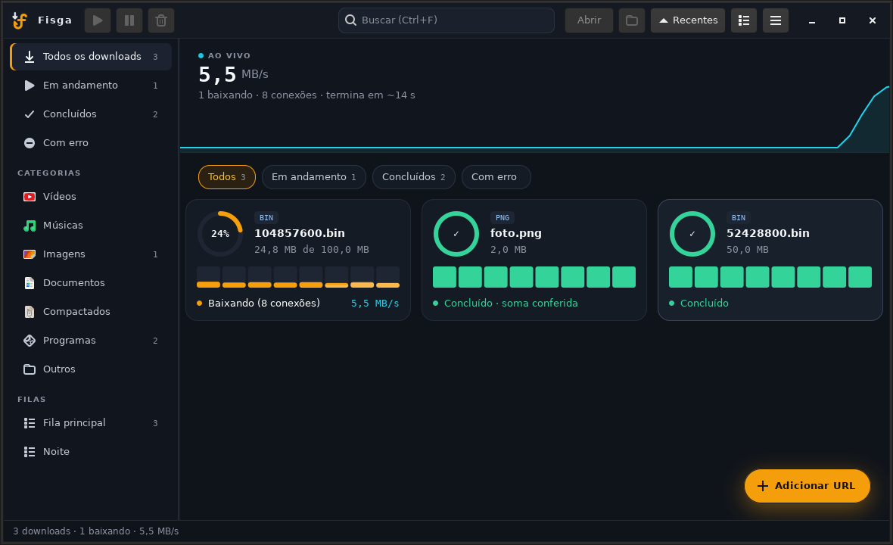
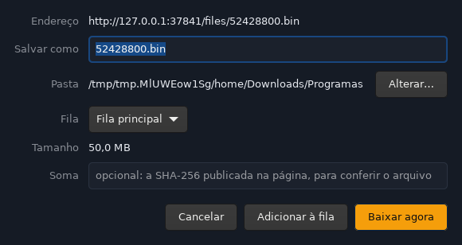

<p align="center">
  
</p>

<h1 align="center">Fisga</h1>

<p align="center">
  Gerenciador de downloads para Linux, inspirado no IDM.<br>
  Várias conexões por arquivo, filas, agendador e uma extensão que fisga downloads e vídeos do navegador.
</p>



## O que faz

- **Rápido:** divide cada arquivo em até 32 conexões e continua de onde parou, mesmo depois de
  desligar o computador.
- **Extensão para Chrome e Firefox:** pega os downloads do navegador e põe um botão **Baixar** sobre
  vídeos e músicas de qualquer site (YouTube e outros, pelo yt-dlp). Alt+clique num link manda o
  link direto para o Fisga.
- **Janela "Novo download"**, como no IDM: confira nome, pasta e fila antes de começar.
- **Filas e agendador:** quantos downloads ao mesmo tempo, horário para começar e parar, suspender
  ou desligar ao terminar.
- **Organizado:** categorias por tipo (Vídeos, Músicas, Programas...), cada uma na sua pasta.
- **E mais:** limite de velocidade, proxy, login por site, soma SHA-256, antivírus e comando ao
  concluir, ícone na bandeja, captura de links copiados.



## Instalar

**Arch Linux** (pacote `fisga-git`):

```bash
git clone https://github.com/Michaeljhoni/Fisga.git
cd Fisga/packaging/arch && makepkg -si
```

**Outras distros** (precisa de Rust e do GTK ≥ 4.12 com os cabeçalhos):

```bash
scripts/install-dev.sh
```

Opcionais: `yt-dlp` e `ffmpeg` (vídeos de sites), `libnotify`, `wl-clipboard` e `clamav`.

Depois, carregue a extensão no navegador:

- **Chrome, Brave, Edge, Vivaldi:** `chrome://extensions` → Modo do desenvolvedor → Carregar sem
  compactação → `/usr/share/fisga/extension/chrome` (ou `extension/dist/chrome`, sem o pacote).
- **Firefox:** `about:debugging` → Carregar extensão temporária →
  `/usr/share/fisga/extension/firefox/manifest.json`.

## Pelo terminal

```bash
fisga add https://exemplo.com/arquivo.iso   # manda para a fila
fisga list                                  # o que está baixando
fisga pause 3 && fisga resume 3
fisga settings --speed-limit 2048           # no máximo 2 MB/s, somando tudo
fisga stop                                  # pausa tudo e encerra o serviço
```

## Mais

- [Guia completo](docs/GUIA.md): todas as opções, a extensão, regras de janela para niri, Sway e
  Hyprland, problemas comuns e o caminho de quem vinha do LDM, o nome antigo.
- [Para quem vai mexer no código](docs/CONTINUAR.md).
